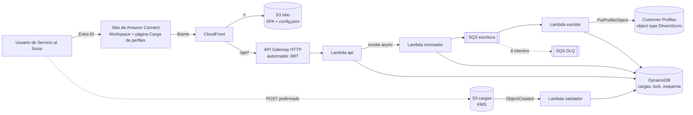
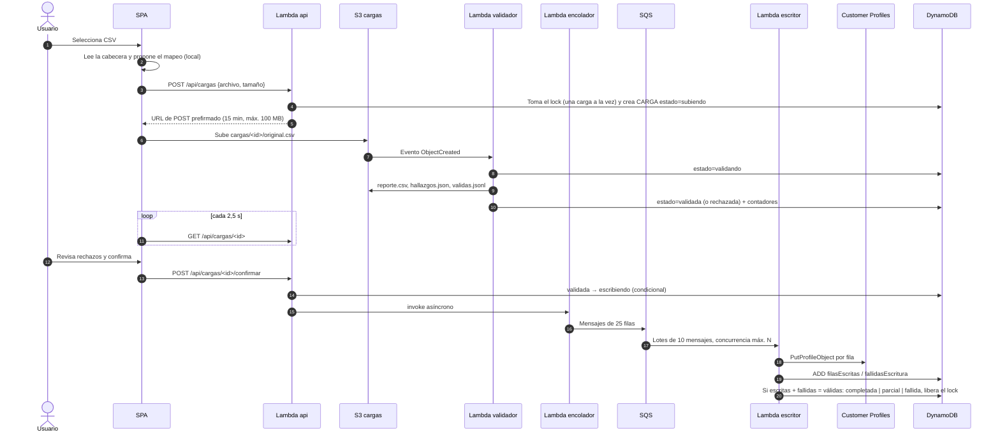
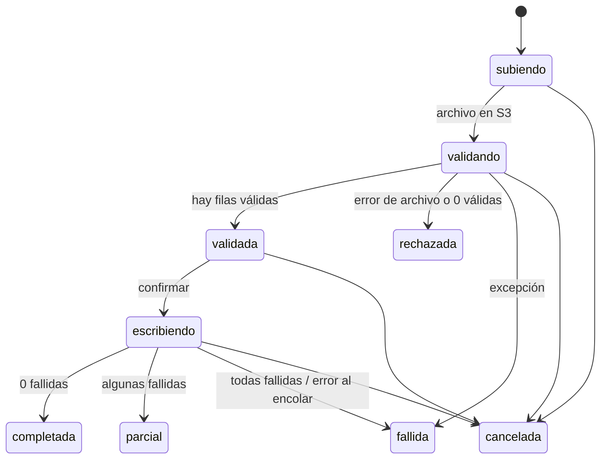

# Arquitectura · App de carga de perfiles

Diners Club Perú · Modernización del contact center. 27 de octubre de 2026.
Contexto funcional y preguntas abiertas en [3P-APP-CARGA-CUSTOMER-PROFILES.md](../3P-APP-CARGA-CUSTOMER-PROFILES.md).

La app permite que Servicio al Socio cargue la base completa de socios (unos 176.865) en Amazon Connect Customer Profiles **sin depender de DFX5**: sube un CSV, revisa la validación fila por fila, confirma y la app escribe los perfiles. Corre embebida en una página del workspace de Connect y todo se despliega con Terraform.

---

## 1. Vista general



| Capa | Servicio | Responsabilidad |
|---|---|---|
| Presentación | React + Cloudscape, CloudFront, S3 | SPA embebible en Connect, cabeceras de seguridad, `config.json` por ambiente |
| Identidad | Entra ID (OIDC + PKCE) | Login del usuario; el token llega a la API |
| API | API Gateway HTTP + Lambda `api` | Autorización por grupos, ciclo de vida de la carga, esquema, URLs prefirmadas |
| Procesamiento | Lambdas `validador`, `encolador`, `escritor` + SQS | Validar, encolar y escribir con reintentos y concurrencia controlada |
| Estado | DynamoDB, S3 | Historial y auditoría, lock, versiones del esquema, archivos y reportes |
| Destino | Customer Profiles | Perfil maestro del socio, clave DNI → `AccountNumber` |

---

## 2. Flujo de una carga



### Estados



Todas las transiciones usan escrituras condicionales en DynamoDB (`estado = esperado`), así un doble clic o dos pestañas no pueden confirmar dos veces. El frontend traduce estos estados a sus fases: `subiendo/validando → validando`, `validada → confirmacion`, `escribiendo → escribiendo`, finales `→ listo`.

---

## 3. Frontend

Ubicación: `src/`. React 18, Cloudscape, Vite.

| Archivo | Rol |
|---|---|
| `main.tsx` | Lee `/config.json`, inicializa API y OIDC, procesa el retorno del popup de login |
| `config.ts` | Sin `config.json` (desarrollo local) la app corre en **modo simulado**; con él, en **modo API** |
| `auth.ts` | `oidc-client-ts` con PKCE. Token en `sessionStorage`. Dentro del iframe usa **popup** (Entra ID no se deja embeber); fuera, redirect |
| `connect.ts` | SDK de Connect (`@amazon-connect/app` y `contact` 1.0.14). Dentro de Connect lee ARN, nombre y perfil de enrutamiento del usuario; fuera de Connect devuelve `null` en hasta 4 s y la app sigue sin SDK |
| `components/AccesoConnect.tsx` | Franja con el usuario de Connect y pantalla de acceso denegado si el perfil de enrutamiento no está en `perfilesPermitidos` |
| `api.ts` | Cliente de la API con `Authorization: Bearer`; subida directa a S3 con `FormData` |
| `useCargaSimulada.ts` | Controlador simulado (datos de `mock.ts`) y contrato común `ControladorCarga` |
| `useCargaApi.ts` | Controlador real: crea la carga, sube, hace polling, confirma, cancela, publica el esquema, descarga reportes. Retoma una carga abierta al recargar la página |
| `App.tsx` | Elige el controlador según el modo; la vista es la misma |
| `components/*` | `NuevaCarga` (subida de `.xlsx` o `.csv`, mapeo, confirmación con hallazgos reales), `Resultado`, `Historial`, `EstadoBase`, `MapeoPerfiles` |

El mismo build sirve para todos los ambientes: Terraform publica `config.json` (sin secretos) con issuer, client ID, scope, instancia y perfiles de enrutamiento permitidos.

### Identidad: SDK de Connect más token OIDC

| Dónde se abre | Interfaz | API |
|---|---|---|
| Dentro de Connect | El SDK identifica al usuario. Si su perfil de enrutamiento no está permitido, ve una pantalla de acceso denegado | Exige el token de Cognito o Entra ID. El contexto de Connect viaja en cabeceras `X-Connect-*` y se guarda en la carga como `usuarioConnect` con `verificado: false` |
| Fuera de Connect | Sin SDK; solo login | Exige el token |

El filtro por perfil de enrutamiento es un control de interfaz: los datos del SDK no están firmados y el backend no puede verificarlos. La autorización real sigue en el token y el grupo. Requiere los permisos `User.Details.View` y `User.Configuration.View` en el registro de la app en Connect, que Terraform declara en `connect.tf`.

---

## 4. Backend

Ubicación: `backend/src/carga/`. Python 3.12, arm64, un solo paquete para las cuatro funciones.

| Módulo / función | Disparador | Qué hace |
|---|---|---|
| `api.handler` | API Gateway | Rutas de la tabla de abajo. Valida grupos del token, nombre y tamaño del archivo |
| `procesos.validador` | Evento S3 `cargas/*/original.csv` u `original.xlsx` | Lee el archivo, valida cada fila y escribe reportes (ver «Formatos admitidos») |
| `procesos.encolador` | Invocación asíncrona desde `api` | Parte `validas.jsonl` en mensajes de 25 filas y los envía a SQS |
| `procesos.escritor` | SQS | `PutProfileObject` por fila; errores de throttling reintentan el mensaje; actualiza contadores y cierra la carga |
| `reglas.py` | — | Reglas de negocio y mapeo destino → campo del object type; un único validador para CSV y Excel |
| `xlsx.py` | — | Lector de `.xlsx` con la biblioteca estándar (zip + XML en streaming), sin dependencias que empaquetar |
| `comun.py` | — | Clientes AWS con reintentos adaptativos, helpers de DynamoDB, lock |

### API

Todas las rutas exigen token válido (autorizador JWT de API Gateway).

| Método y ruta | Permiso | Descripción |
|---|---|---|
| `GET /api/cargas` | autenticado | Últimas 50 cargas (historial) |
| `POST /api/cargas` | `grupos_carga` | Crea la carga, toma el lock y devuelve el POST prefirmado |
| `GET /api/cargas/{id}` | autenticado | Estado y contadores |
| `POST /api/cargas/{id}/confirmar` | `grupos_carga` | `validada → escribiendo` y dispara el encolado |
| `POST /api/cargas/{id}/cancelar` | `grupos_carga` | Cancela una carga en curso y libera el lock |
| `GET /api/cargas/{id}/reporte` | autenticado | URL prefirmada (5 min) del CSV de hallazgos |
| `GET /api/cargas/{id}/hallazgos` | autenticado | URL prefirmada del JSON con los primeros 5.000 hallazgos |
| `GET /api/esquema` | autenticado | Esquema de mapeo publicado |
| `PUT /api/esquema` | `grupos_admin` | Publica la versión N+1 (control optimista de concurrencia) |

### Formatos admitidos

| Formato | Lectura | Normalización |
|---|---|---|
| **Excel `.xlsx`** | Primera hoja del libro, en streaming. Textos compartidos, celdas en línea, números y booleanos | DNI numérico con menos de 8 dígitos recupera los ceros a la izquierda (`1234567` → `01234567`); fechas guardadas como serial de Excel pasan a `AAAA-MM-DD`; números como `5.1987654321E10` vuelven a `51987654321` |
| **CSV** | UTF-8 con o sin BOM, o Latin-1 (Excel en español). Delimitador `;` o `,` detectado por la cabecera | Ninguna: el valor se valida tal cual |

El `.xls` antiguo (binario) no se admite. Un archivo sin las columnas nuevas (por ejemplo, sin `fecha_nacimiento`) sigue funcionando porque es opcional.

### Reglas de validación

| Destino | Regla | Si falla |
|---|---|---|
| `AccountNumber` (DNI) | 8 dígitos, único en el archivo | Rechazo |
| `FirstName` | Obligatorio (almacena el nombre completo del socio) | Rechazo |
| `MobilePhoneNumber` | `51` + 9 dígitos; se guarda como `+51…` | Rechazo; vacío = advertencia |
| `PersonalEmailAddress` | Formato de correo; se guarda en minúsculas | Rechazo |
| `SegmentoValor` | 1, 2 o 3 | Rechazo; vacío = advertencia (grupo general) |
| `MarcaRetener` | 1 o 2 | Rechazo |
| `TieneOferta` | S/SI/N/NO → `S`/`N` | Rechazo |
| `Tea` | Decimal 0–200 (acepta coma decimal) | Rechazo; vacío con oferta `S` = advertencia |
| `FechaAfiliacion` | `AAAA-MM-DD`, no futura | Rechazo |
| `TipoProducto` | Free, Hiraoka, Club, Miles, Special Edition, Carte Blanche | Rechazo |
| `BirthDate` (`fecha_nacimiento`) | `AAAA-MM-DD`, no futura. Opcional; para el saludo de cumpleaños | Rechazo si viene mal; vacío no genera hallazgo |
| `ScoreOferta` | A, B, C, D o E. Opcional; decide el canal de llamada de venta | Rechazo si viene con valor distinto; vacío = advertencia |
| `LineaCredito` | Texto libre (ej. `S/ 12.000`, `US$ 5.000`). Opcional; constancia de socio (D15) | Sin validación de formato; vacío no genera hallazgo |
| `CallcenterCobranza` | Texto libre (GEINCOS, XLCORP o vacío si no aplica). Base D13 | Sin validación de formato; vacío no genera hallazgo |
| `CentralCobranza` | Texto libre. Teléfono de la central; el agente lo da al socio en N1 | Sin validación de formato; vacío no genera hallazgo |
| `Refinanciado` | S/SI/N/NO → `S`/`N`. Opcional; cambia la respuesta de N1 | Rechazo si viene con valor distinto; vacío no genera hallazgo |

Columnas obligatorias que faltan en la cabecera rechazan el archivo entero. Una fila con cualquier rechazo no se escribe; las advertencias no bloquean.

### Archivos por carga en S3

```
cargas/<id>/original.xlsx    archivo subido (o original.csv)
cargas/<id>/reporte.csv      todos los hallazgos (con BOM para Excel)
cargas/<id>/hallazgos.json   primeros 5.000 para la pantalla
cargas/<id>/validas.jsonl    filas listas para escribir
```

Se borran solos a los `dias_retencion_archivos` (30 por defecto), porque contienen datos personales.

### Modelo en DynamoDB (tabla única)

| `pk` | `sk` | Contenido |
|---|---|---|
| `CARGA#<id>` | `META` | Estado, usuario, archivo, contadores, quién confirmó/canceló. GSI `gsi1` (`CARGAS`, fecha) para el historial |
| `LOCK` | `LOCK` | Carga activa; expira a las 6 horas por si algo queda colgado (TTL `expira`) |
| `ESQUEMA` | `ACTUAL` | Esquema vigente y su versión |
| `ESQUEMA` | `V#0001…` | Historial de versiones publicadas |

---

## 5. Customer Profiles

- **Object type `DinersSocio`**: 16 campos `_source.<campo>` → `_profile.*` (11 originales + 5 confirmados el 26–27 de octubre). Los nombres deben coincidir entre `reglas.CAMPO_OBJECT_TYPE` (Python) y `local.campos_object_type` (Terraform).
- **Claves**:
  - `_account` sobre `account_number` (DNI), `PROFILE + UNIQUE`. Identifica un único perfil; búsqueda del agente en WhatsApp. `PutProfileObject` es idempotente por DNI: reintentar un mensaje no duplica perfiles.
  - `_phone` sobre `mobile_phone` (TELEFONO_1), `PROFILE`. Búsqueda por el número que llama en voz (doc viva, 23 de octubre). Sin `UNIQUE` porque un celular puede repetirse entre socios: una búsqueda por teléfono puede devolver más de un perfil, y el flujo de voz debe pedir el documento en ese caso.
- **Expiración**: `dias_expiracion_perfiles` (1.000 por defecto) en dominio y object type. No se usa `CreateUploadJob`, que limita la expiración a 90 días.
- **Identity resolution**: desactivada (una sola fuente, DNI único).
- **Dominio**: se usa el existente de la instancia (`crear_dominio_perfiles = false`) o se crea uno nuevo cifrado con la KMS de la app.
- **Semántica**: upsert. Un socio que deja de venir en el archivo no se borra; expira según la retención. Una celda opcional vacía no borra el valor anterior del perfil.
- **Cambios de esquema**: los perfiles existentes no se reprocesan. Si se cambia un destino o una columna deja de ser obligatoria, la pantalla de revisión lo advierte y exige confirmarlo antes de publicar; lo que corresponde después es recargar la base completa.
- **Protección**: el dominio y el object type tienen `prevent_destroy`. Terraform rechaza cualquier plan que los borre o reemplace (por ejemplo, al cambiar `object_type_name`), porque eso eliminaría los objetos de todos los socios.

---

## 6. Infraestructura (Terraform)

```
infra/
├── terraform/
│   ├── modules/carga_perfiles/   módulo reutilizable
│   │   ├── main.tf       KMS, DynamoDB + esquema inicial, SQS + DLQ, dominio y object type
│   │   ├── s3.tf         buckets de cargas y sitio, CORS, notificación, config.json
│   │   ├── lambda.tf     empaquetado, rol IAM, 4 funciones, logs, mapeo SQS
│   │   ├── api.tf        HTTP API, autorizador JWT, rutas, stage con throttling y access logs
│   │   ├── cdn.tf        CloudFront, OAC, CSP, función SPA
│   │   ├── connect.tf    integración de Connect (opcional) y alarmas
│   │   ├── variables.tf / outputs.tf / versions.tf
│   └── envs/dev/         root del ambiente: providers, variables, ejemplo de tfvars
├── publicar-frontend.ps1 build + sync a S3 + invalidación
└── README.md             pasos de despliegue
```

Providers: `hashicorp/aws ~> 5.80`, `hashicorp/awscc ~> 1.20` (object type e integración de Connect, que el provider clásico no cubre), `hashicorp/archive`.

### Variables principales

| Variable | Uso |
|---|---|
| `oidc_issuer`, `oidc_client_id`, `oidc_audiences`, `oidc_scope` | App registration de Entra ID |
| `grupos_carga`, `grupos_admin` | Object IDs de grupos de Entra ID; vacío = cualquier usuario autenticado |
| `connect_instance_alias`, `connect_instance_arn` | `frame-ancestors` y registro de la integración |
| `crear_dominio_perfiles`, `dominio_perfiles` | Dominio existente o nuevo |
| `concurrencia_escritura` | Lambdas escritoras en paralelo (2–50); controla las TPS contra Customer Profiles |
| `dias_retencion_archivos`, `dias_retencion_logs`, `dias_expiracion_perfiles` | Retenciones |
| `sns_alarmas_arn` | Notificación de alarmas |

### Outputs

`url_app` (access URL para Connect), `redirect_uri` (para Entra ID), `bucket_sitio`, `distribucion_id`, `dominio_perfiles`, `object_type`.

---

## 7. Seguridad

| Tema | Control |
|---|---|
| Autenticación | Entra ID con PKCE, sin client secret; token en `sessionStorage` |
| Autorización | Autorizador JWT en API Gateway + grupos verificados en la Lambda. Estar dentro de Connect no es autorización |
| Embebido | CSP `frame-ancestors` solo para la instancia de Connect; sin `X-Frame-Options` |
| Cabeceras | CSP restrictiva, HSTS, `nosniff`, `Referrer-Policy` |
| Datos en reposo | KMS propia con rotación para bucket de cargas, DynamoDB y SQS; dominio con KMS si se crea |
| Datos en tránsito | TLS obligatorio (políticas de bucket deniegan HTTP), CloudFront redirige a HTTPS |
| Buckets | Bloqueo de acceso público, `BucketOwnerEnforced`; el sitio solo se lee vía OAC |
| Subida | POST prefirmado de 15 min, con rango de tamaño y clave fija por carga |
| Mínimo privilegio | Rol de Lambda limitado a la tabla, `cargas/*`, la cola, la KMS, el encolador y `PutProfileObject` sobre el object type |
| Abuso | Throttling en el stage (20 rps, ráfaga 50); una carga a la vez |
| Auditoría | Usuario que crea, confirma y cancela en DynamoDB; access logs de API con usuario e IP; X-Ray |
| Retención | Archivos con PII se borran a los 30 días; logs a los 90 |

**Expuesto a internet:** la URL de API Gateway y la de CloudFront son públicas. Las protege el token, no la red. Si ciberseguridad lo pide, se agrega WAF con lista de IP de Diners en CloudFront.

---

## 8. Operación

- **Concurrencia:** el lock impide dos cargas simultáneas. Expira a las 6 horas si una carga queda colgada.
- **Reintentos:** errores de throttling o 5xx devuelven el mensaje a la cola (visibilidad 12 min). Tras 8 intentos va a la DLQ.
- **Alarmas:** mensajes en la DLQ y errores en cada Lambda.
- **Carga atascada:** si hay mensajes en la DLQ, la carga queda en `escribiendo`. Se resuelve redirigiendo la DLQ a la cola o cancelando desde la app.
- **Cancelar durante la escritura:** el escritor descarta los mensajes pendientes; lo ya escrito queda escrito (no hay rollback).
- **Rendimiento estimado:** con concurrencia 5, del orden de cientos de perfiles por segundo, sujeto a la cuota de `PutProfileObject` de la cuenta. **No medido**; ajustar `concurrencia_escritura` tras la primera prueba.

---

## 9. Despliegue

1. Cuenta con Customer Profiles habilitado en la instancia y **sin SCP que bloquee `connect:*` ni `profile:*`** (la cuenta sandbox de DFX5 no sirve).
2. `infra/terraform/envs/dev/terraform.tfvars` a partir del ejemplo.
3. `terraform -chdir=infra/terraform/envs/dev init`, `plan`, `apply`.
4. Registrar `redirect_uri` como Redirect URI (SPA) en Entra ID; `accessTokenAcceptedVersion: 2` en la API.
5. `./infra/publicar-frontend.ps1 -Ambiente dev`.
6. Connect admin website → UI Management → Workspaces: página «Carga de perfiles» con la aplicación, asignada a Servicio al Socio.

Desarrollo local: `npm run dev` corre en modo simulado, sin AWS.

---

## 10. Verificado y pendiente

**Verificado:** `terraform validate` y `plan` (56 recursos) contra la cuenta sandbox; flujo completo del backend contra AWS simulado (moto); lint, type check y build del frontend.

**No verificado:** despliegue real, login con Entra ID, render del componente en una view de Connect para un usuario sin perfil de enrutamiento, throughput real de Customer Profiles.

**Pendiente:**
- Estado remoto de Terraform según el pipeline de Diners (bloque `backend "s3"` comentado).
- El identificador elegido en la pantalla de esquema no cambia las claves del object type; esas las define Terraform.
- En `.xlsx`, la vista previa del mapeo en el navegador usa las columnas esperadas, no las del archivo. La validación real en el backend sí lee la cabecera del Excel.
- Probar con el Excel real de Servicio al Socio: el lector se verificó con libros generados, no con uno guardado por Excel.
- **`NOMBRE_SOCIO` almacenado en `FirstName`**: la base de Diners entrega el nombre completo en una sola columna. Se mapea a `_profile.FirstName`; `LastName` queda vacío. Si en una fase posterior la base separa nombre y apellido, hay que agregar `last_name` a `CAMPO_OBJECT_TYPE` / `campos_object_type` en Terraform y recargar la base completa para poblar el campo.
- **MONTO_OFERTA** (propuesta de DFX5, pendiente de confirmar por Diners): monto preaprobado para comunicar al socio sin asesor. No está en el esquema; se agrega cuando Diners lo confirme.
- Respuestas del TL que cambian el diseño: semántica de bajas (upsert vs. reemplazo), D13 en el mismo archivo o aparte, carga completa vs. muestra en desarrollo.
