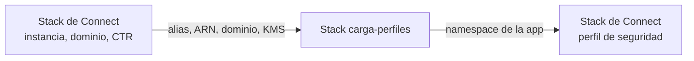

# Contrato con el stack de Connect

La app de carga de perfiles no crea el dominio de Customer Profiles. Lo crea el stack de Connect, que es dueño de la instancia. Este documento lista lo que cada stack necesita del otro, con ejemplos de código para el stack de Connect.

## Orden de despliegue



El segundo paso del stack de Connect (dar acceso a la app desde el perfil de seguridad) depende de un output de este stack. Hay dos formas de resolverlo: un segundo apply del stack de Connect, o hacerlo a mano en el admin website. En ambos casos el namespace es un valor fijo y conocido de antemano (`<nombre>-<ambiente>`, por defecto `diners-carga-perfiles-dev`), así que el stack de Connect también puede declararlo como constante y evitar la dependencia.

## Lo que este stack recibe

| Variable | Qué es | Obligatoria |
|---|---|---|
| `connect_instance_alias` | Alias de la instancia (`<alias>.my.connect.aws`). Va en el `frame-ancestors` de la CSP | Sí |
| `connect_instance_arn` | ARN de la instancia. Vacío = no se registra la app en Connect | Sí, salvo pruebas sin Connect |
| `dominio_perfiles` | Nombre del dominio de Customer Profiles | Sí |
| `kms_dominio_perfiles_arn` | `DefaultEncryptionKey` del dominio. El escritor la usa con sus propias credenciales al llamar a `PutProfileObject` | Sí, si el dominio usa CMK |

## Lo que este stack entrega

| Output | Para qué lo usa el stack de Connect |
|---|---|
| `app.nombre_app_connect` | Namespace de la app. Va en el perfil de seguridad (Agent Applications) y es el **App Name** del componente de la view |
| `application_arn` | ARN de la app en AppIntegrations, por si se referencia desde otra integración |
| `lambda_role_arn` | Rol de las Lambdas. Solo hace falta si la key policy de la KMS del dominio no delega en IAM (ver abajo) |
| `app.url_app` | URL de CloudFront, si se usa un componente Link en una página del workspace |

## Lo que el stack de Connect tiene que crear

Este código salió del módulo de la app en esta versión. Estaba aplicado en la cuenta sandbox, así que la configuración es la que se probó allí. Ajusta nombres y variables a la convención del repo.

```hcl
# Dominio de Customer Profiles. Borrarlo o reemplazarlo elimina todos los perfiles de socios.
resource "aws_customerprofiles_domain" "connect" {
  domain_name             = "amazon-connect-${var.connect_instance_alias}"
  default_expiration_days = 1000 # igual a dias_expiracion_perfiles del stack de carga
  default_encryption_key  = aws_kms_key.perfiles.arn
  matching {
    # Una sola fuente y DNI único: la fusión automática solo agrega riesgo de unir socios distintos.
    enabled = false
  }
  lifecycle {
    prevent_destroy = true
  }
}

# Registros de contacto. CTR-AutoAssociateOnly asocia contactos a perfiles existentes y no crea perfiles
# inferidos, así la app de carga es la única fuente de perfiles de socios.
resource "awscc_customerprofiles_object_type" "ctr" {
  domain_name      = aws_customerprofiles_domain.connect.domain_name
  object_type_name = "CTR"
  description      = "Registros de contacto de Amazon Connect."
  template_id      = "CTR-AutoAssociateOnly"
}

# Vínculo dominio <-> instancia (lo que hace la consola al habilitar Customer Profiles).
# Sin esto, el Agent Workspace y el bloque Customer profiles de los flujos no usan el dominio.
resource "awscc_customerprofiles_integration" "connect" {
  domain_name      = aws_customerprofiles_domain.connect.domain_name
  uri              = aws_connect_instance.this.arn
  object_type_name = awscc_customerprofiles_object_type.ctr.object_type_name
}

output "dominio_perfiles" {
  value = aws_customerprofiles_domain.connect.domain_name
}

output "kms_dominio_perfiles_arn" {
  value = aws_kms_key.perfiles.arn
}
```

### KMS del dominio

Con la key policy por defecto (la cuenta delega en IAM), no hace falta nada más: la política IAM del rol de las Lambdas ya incluye `kms:Decrypt`, `kms:Encrypt` y `kms:GenerateDataKey` sobre `kms_dominio_perfiles_arn`. Si la key policy enumera principales, agrega `lambda_role_arn` con esas tres acciones.

### Acceso a la app desde el perfil de seguridad

El permiso es por namespace. En CloudFormation y en `awscc_connect_security_profile` es el atributo `applications`:

```hcl
applications = [
  {
    namespace               = "diners-carga-perfiles-dev" # output app.nombre_app_connect
    application_permissions = ["ACCESS"]
  }
]
```

**No probado como código.** En el sandbox se dio a mano, en el admin website. Ten en cuenta que `awscc_connect_security_profile` administra el perfil completo: si el stack de Connect no define ya sus perfiles de seguridad como código, es más seguro dar este permiso a mano que importar el perfil solo por esto.

## Cableado entre stacks

El stack de carga recibe todo por variables, así que funciona con cualquier mecanismo del repo. Dos opciones:

**tfvars (lo que trae el ejemplo).** Se copian los outputs del stack de Connect a `envs/<ambiente>.tfvars`. Es simple, pero hay que actualizarlos a mano si cambian.

**Leer el estado del stack de Connect.** Reemplaza las cuatro variables de entrada en `terraform/stack/main.tf`:

```hcl
data "terraform_remote_state" "connect" {
  backend = "s3"
  config = {
    bucket = "<bucket-de-estado>"
    key    = "diners/connect/${var.ambiente}.tfstate"
    region = var.region
  }
}

module "carga_perfiles" {
  # ...
  connect_instance_alias   = data.terraform_remote_state.connect.outputs.connect_instance_alias
  connect_instance_arn     = data.terraform_remote_state.connect.outputs.connect_instance_arn
  dominio_perfiles         = data.terraform_remote_state.connect.outputs.dominio_perfiles
  kms_dominio_perfiles_arn = data.terraform_remote_state.connect.outputs.kms_dominio_perfiles_arn
}
```

Los nombres de los outputs dependen del stack de Connect. Si el repo usa Terragrunt, el equivalente es un bloque `dependency` que pasa esos mismos cuatro valores como `inputs`.
