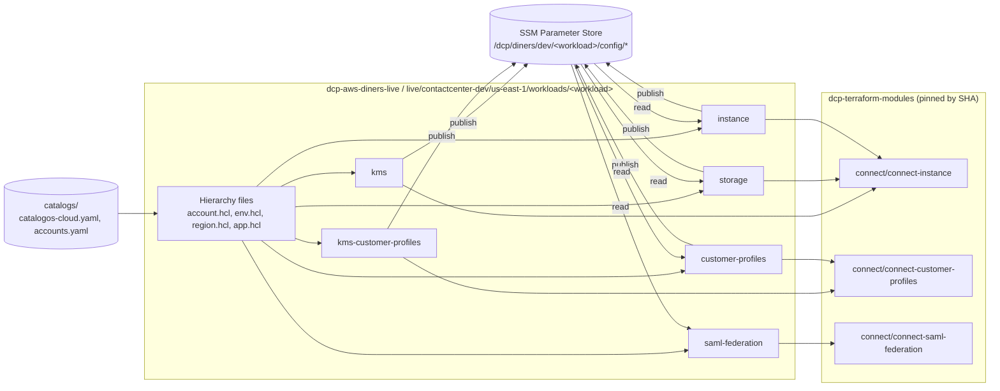
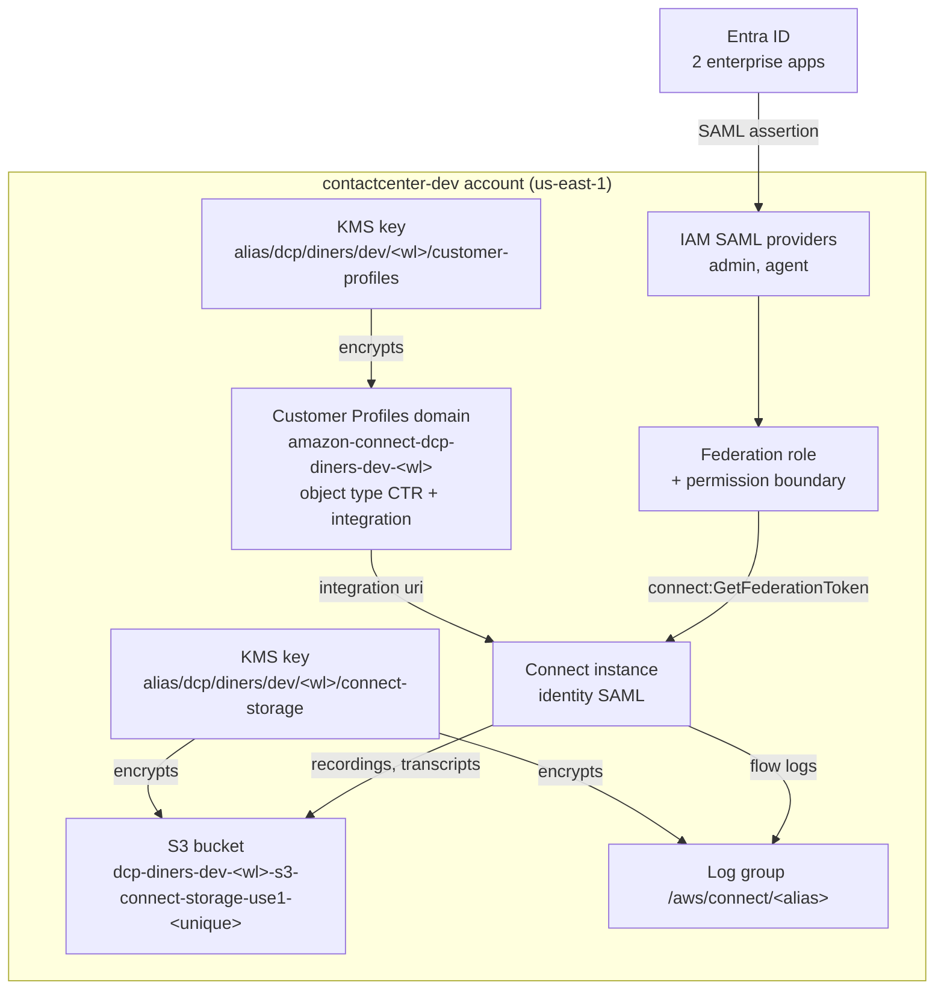
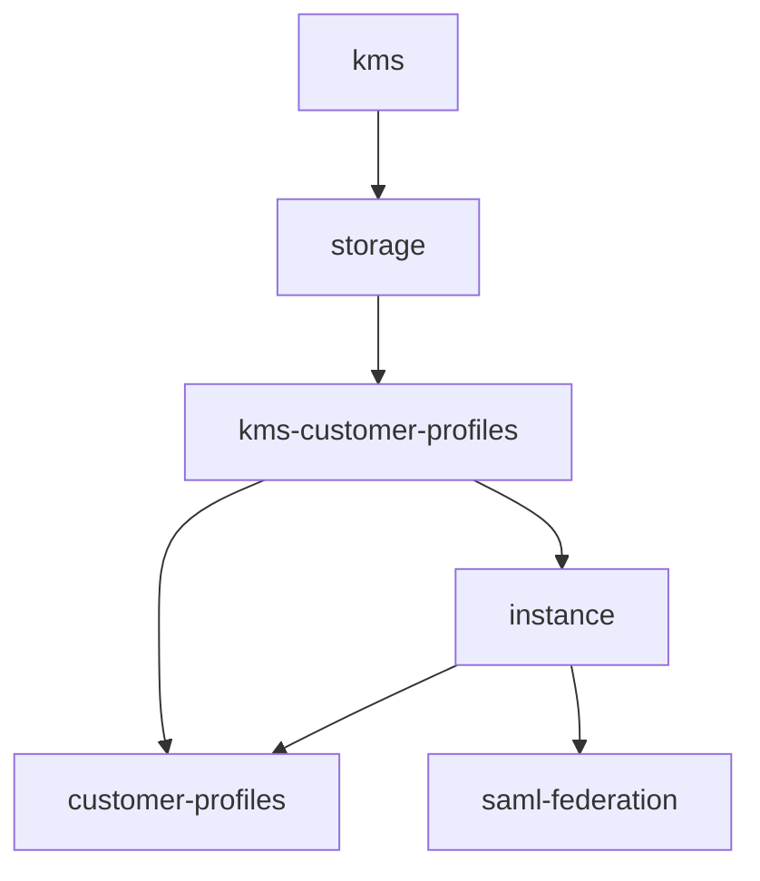
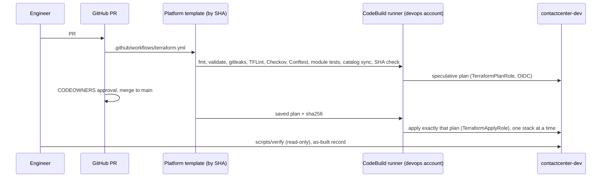

# Amazon Connect initial build (dev)

This folder holds the code for the first Amazon Connect contact center environment of Diners Club Perú, `contactcenter-dev`. It is the implementation of the spec in `.kiro/specs/connect-instance-initial-build/` (`requirements.md`, `design.md`, `tasks.md`).

The folder contains working copies of two repositories:

| Folder | Real repository | What it holds |
|---|---|---|
| `dcp-terraform-modules/` | `Diners/dcp-terraform-modules` | Three reusable Terraform modules under `modules/connect/` |
| `dcp-aws-diners-live/` | `Diners/dcp-aws-diners-live` | Terragrunt live configuration, six dev stacks, guardrails and CI scripts |

The post-apply verification scripts are outside this folder, in `../scripts/verify/`.

Nothing here has been applied. The stacks are blocked by open questions (OQ-n) and placeholder module SHAs. See [Status and blockers](#status-and-blockers).

## What gets built

In the `contactcenter-dev` account, region `us-east-1`:

- **Storage KMS key**: customer-managed key with rotation, for recordings, transcripts and contact flow logs.
- **Storage bucket**: S3 bucket for call recordings and chat transcripts. Block Public Access, `BucketOwnerEnforced`, versioning, SSE-KMS, lifecycle and a bucket policy that denies non-TLS access and wrong keys.
- **Customer Profiles KMS key**: a separate key for the profiles domain. A third-party profiles app can use it later through an optional statement.
- **Connect instance**: SAML identity, inbound and outbound calls, contact flow logs and Contact Lens, plus the storage configs for recordings and transcripts and the log group `/aws/connect/<alias>`.
- **Customer Profiles domain**: `amazon-connect-dcp-diners-dev-<workload>`, object type `CTR` (template `CTR-AutoAssociateOnly`) and the integration with the instance. The data store is off by default.
- **SAML federation with Entra ID**: two IAM SAML providers (admin and agent apps), one federation role with the permission boundary, and one policy that allows only `connect:GetFederationToken` on the instance users.

## Architecture

### How the pieces fit



### AWS resources in the account



### Sign-in flow

1. The user opens the admin or agent app from the Entra ID "My Apps" portal (IdP-initiated).
2. Entra ID sends a SAML assertion with the role claim `<role-arn>,<provider-arn>` and `SessionDuration = 900`.
3. AWS STS runs `AssumeRoleWithSAML` on the federation role. The trust policy requires `SAML:aud = https://signin.aws.amazon.com/saml`.
4. The role calls `connect:GetFederationToken`, and the relay state sends the user to `/connect` (admin) or `/agent-app-v2` (agent).
5. The Connect username must equal the user's UPN.

### Stacks and apply order

Each stack is one root module with its own state. Stacks never read each other's state. A publisher writes an SSM parameter and the consumer's module reads it with a data source that has no fallback, so a missing value fails the plan.



| # | Stack | Module / component | Reads from SSM | Publishes to SSM |
|---|---|---|---|---|
| 1 | `kms` | connect-instance / `kms` | `key-admin-role-arn` (external) | `connect-kms-key-arn` |
| 2 | `storage` | connect-instance / `storage` | `connect-kms-key-arn` | `connect-storage-bucket-name` |
| 3 | `kms-customer-profiles` | connect-customer-profiles / `kms` | `key-admin-role-arn`, `profiles-app-role-arn` (optional) | `customer-profiles-kms-key-arn` |
| 4 | `instance` | connect-instance / `instance` | `connect-kms-key-arn`, `connect-storage-bucket-name` | `connect-instance-id`, `-arn`, `-alias` |
| 5 | `customer-profiles` | connect-customer-profiles / `domain` | `customer-profiles-kms-key-arn`, `connect-instance-arn` | `customer-profiles-domain-name`, `-arn` |
| 6 | `saml-federation` | connect-saml-federation | `connect-instance-arn`, `saml-metadata-admin`, `saml-metadata-agent` | (outputs only: role claims, relay state URLs) |

Terragrunt `dependencies` blocks carry order only, with no `mock_outputs`. A stack that publishes a contract merges in an earlier PR than the stacks that consume it.

### Pipeline



No apply runs from a laptop. Outside the pipeline you can only plan.

## Repository layout

### `dcp-terraform-modules/`

```
compatibility.yaml          registered module SHAs and providers
CHANGELOG.md, PR-NUEVO-MODULO.md, .tflint.hcl
modules/connect/
  connect-instance/         Connect_Module: component = kms | storage | instance
    kms.tf storage.tf instance.tf
  connect-customer-profiles/  Profiles_Module: component = kms | domain
    kms.tf domain.tf
  connect-saml-federation/  SAML_Module: providers, role, policy (main.tf)
```

Each module also has `variables.tf`, `outputs.tf`, `versions.tf`, `locals.tf`, `README.md`, `examples/basic`, `examples/production` and `tests/`:

- `validations.tf` and `naming.tf` hold the pure logic (input checks and physical names). They need no provider, so they can be tested without AWS credentials.
- `tests/*.tftest.hcl` are the `terraform test` files.
- `tests/pbt/` is a Python property-test harness (pytest + Hypothesis) that runs the pure logic through a fixture.

One module serves several stacks through the `component` switch. That keeps one SHA, one README and one test suite per module, while each stack keeps its own state.

### `dcp-aws-diners-live/`

```
terragrunt.hcl, domain.hcl, state.hcl   root configuration
catalogs/                               catalogos-cloud.yaml, accounts.yaml
live/contactcenter-dev/
  account.hcl  env.hcl                  account, environment, stack_inputs, adopt
  us-east-1/region.hcl
  us-east-1/workloads/OQ-1-workload/    folder name is a placeholder until OQ-1
    app.hcl                             workload, owner, cost center, classification
    kms/ storage/ kms-customer-profiles/ instance/ customer-profiles/ saml-federation/
live/{dev,qa,stg,prod}/...              existing sample "merchants" stacks
policies/terraform/conftest/
  connect_guardrails.rego               new rules for this build
  tags.rego, workload_guardrails.rego   existing
scripts/ci/
  scan_stack_files.py                   rejects literals and unpinned modules in stack files
  compare_env_folders.py                checks stack files are identical across contactcenter-<env>
.github/CODEOWNERS, .github/workflows/terraform.yml
```

### Root `terragrunt.hcl`

Every stack includes the root file. The root file does the following:

- Generates `backend.tf`: S3 bucket per tier (`dev/qa/stg` go to `nonprod`), key `diners/<path under live/>/terraform.tfstate`, KMS, native lock file, no DynamoDB.
- Generates `provider.tf`: assume role into `TerraformPlanRole` or `TerraformApplyRole` (from `DCP_TERRAFORM_ROLE`), `allowed_account_ids`, `tag_policy_compliance = "error"`, and `default_tags`.
- Builds the mandatory tags from `domain.hcl`, `env.hcl` and `app.hcl`. For workload stacks, a missing `app.hcl` value fails the plan, with no default.
- Merges `env.hcl` `stack_inputs` into `inputs` (DD-3). That is why stack files hold no environment values and can be copied unchanged to qa, stg and prod.
- Generates `import.tf` from the optional `adopt` map in `env.hcl` (DD-4). This adopts resources that already exist, such as an instance with the same alias, instead of recreating them. When `adopt` is empty the file has only comments.

`backend.tf`, `provider.tf` and `import.tf` are generated and git-ignored. `.terraform.lock.hcl` must be committed, but the pipeline generates it from the Nexus mirror.

### Where each value lives

| Value | File |
|---|---|
| Account key and ID | `account.hcl`, `catalogs/accounts.yaml` |
| `environment` | `env.hcl` |
| Instance alias, identity type, exception ID, retention, `cde_scope`, profiles expiration, data store | `env.hcl` `stack_inputs` |
| Workload, application, owner, cost center, data classification, compliance | `app.hcl` (values from the catalog) |
| Cross-stack ARNs and names | SSM `/dcp/diners/dev/<workload>/config/*` |
| Module source | stack `terragrunt.hcl`, by 40-character SHA |

## Security controls

- **KMS**: rotation on, 30-day deletion window, `prevent_destroy`. The key admin role cannot encrypt or decrypt. Every service statement has an `aws:SourceAccount` condition. No Allow statement has an unconditioned `Principal: "*"`. The storage key never names the profiles app role.
- **S3**: all four Block Public Access settings, `BucketOwnerEnforced`, versioning, SSE-KMS with a bucket key, and Deny statements for non-TLS access, wrong KMS keys and non-KMS encryption.
- **IAM**: the federation role carries `dcp-platform-permission-boundary`, a session of at most 3600 s, and one action on one resource pattern.
- **Data**: Customer Profiles object types define no PAN, CVV, PIN or track fields. A Conftest rule rejects them.
- **Destroy protection**: the keys, bucket, instance and domain use `prevent_destroy`, and a Conftest rule fails any plan that deletes or replaces them.
- **Ownership**: CloudTrail S3 data events and Macie belong to `dcp-aws-security-live`. When `cde_scope = true`, this build only requires a reference to that coverage (DD-2).

## Checks

| Check | Where | Runs |
|---|---|---|
| Input validations and naming | `modules/*/validations.tf`, `naming.tf` | `terraform validate` / plan |
| Module tests | `modules/*/tests/*.tftest.hcl` | `terraform test` |
| Property tests | `modules/*/tests/pbt/` | `pytest` |
| Plan guardrails | `policies/terraform/conftest/connect_guardrails.rego` | `conftest test` on the plan JSON |
| Stack file scan | `scripts/ci/scan_stack_files.py` | PR CI |
| Promotion comparison | `scripts/ci/compare_env_folders.py` | PR CI |
| Post-apply verification | `../scripts/verify/verify-*.sh` | after apply, read-only AWS CLI |
| As-built record | `../scripts/verify/build_as_built.py` | after verification |

The verification scripts write one JSON line per check (`check`, `expected`, `actual`, `result`, `timestamp`). `build_as_built.py` refuses to write the record if any check failed, an area has no evidence, or the PCI decision is missing. The sign-in test is manual and is recorded with `../scripts/verify/saml-signin-record-template.md`.

## Status and blockers

Implemented: the three modules, the guardrails, the CI scripts, the root changes, the dev hierarchy, the six stacks, and the profiles and SAML verification scripts. Not done: the final test checkpoint (task 11) and the optional property tests.

Before anything can merge:

- **Module SHAs**: every stack uses a placeholder `ref=0000...0000`. Each module needs a signed release tag and an entry in `compatibility.yaml`. `scan_stack_files.py` fails until then, by design.
- **`verify-instance.sh`** is marked done in `tasks.md` but does not exist in `../scripts/verify/`.
- **Open questions** that block values:

| OQ | Topic |
|---|---|
| OQ-1 | Workload code and path (the folder is `OQ-1-workload` for now) |
| OQ-2 | Account and network/access prerequisites |
| OQ-3 | Catalog resource code for SAML providers |
| OQ-4, OQ-5 | Account entry and catalog values (owner, cost center) |
| OQ-6 | PCI scope (`cde_scope`) and log retention |
| OQ-7 | Recording and transcript retention |
| OQ-8 | Instance alias |
| OQ-9 | Entra ID metadata and group to security profile mapping |
| OQ-10 | Profiles expiration days and data store decision |
| OQ-11 | Profiles app role (optional) |
| OQ-12 | Whether the `awscc` provider is needed for the CTR object type and integration |
| OQ-13 | Key admin role ARN contract |
| OQ-14 | Naming exception for the `amazon-connect-` domain prefix |

The full list, with owners and context, is in `requirements.md`.

## Design decisions

| ID | Decision |
|---|---|
| DD-1 | The flow log group uses the storage key, so no third key stack is needed. |
| DD-2 | CloudTrail data events and Macie stay in `dcp-aws-security-live`. |
| DD-3 | Environment values come from `env.hcl` `stack_inputs` through the root file. |
| DD-4 | Adoption of existing resources uses a generated `import.tf` driven by `env.hcl` `adopt`. |
| DD-5 | The profiles key policy binds `aws:SourceArn` to the computed domain ARN from the first apply (`bind_domain_arn`). |
| DD-6 | Terraform creates `/aws/connect/<alias>` before the instance, so it controls KMS, retention and tags. |
| DD-7 | SAML metadata is stored in SSM `Advanced` tier as `String`. |

## Further reading

- Spec: `../.kiro/specs/connect-instance-initial-build/`
- Skills: `../.kiro/skills/connect-instance-diners/`, `connect-saml-sso-diners/`, `connect-customer-profiles-diners/`
- IaC standards: `../docs/IaC/` (L00 to L16)
- Module READMEs: `dcp-terraform-modules/modules/connect/*/README.md` (the SAML README has the Entra ID setup guide)
