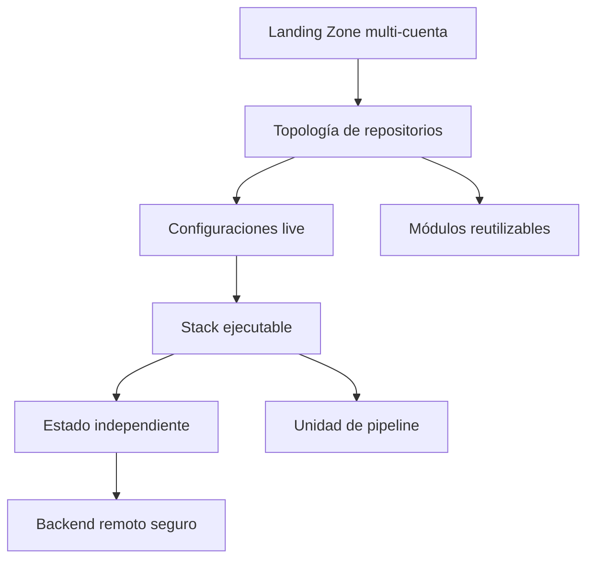

# Arquitectura Terraform para la Landing Zone AWS

## Propósito

Define el modelo arquitectónico de Terraform y Terragrunt para la Landing Zone AWS de Diners Club Perú, incluyendo
la separación de responsabilidades, ambientes, estados y unidades de despliegue.

## Jerarquía de decisiones



La secuencia de decisión es:

- La organización y el ownership determinan el repositorio.
- El ambiente, cuenta, región y capacidad determinan la ubicación `live`.
- El stack lógico determina el root module, backend, estado y pipeline.
- Los módulos reutilizables no contienen datos de ambiente ni de cuenta.
- Las excepciones se registran y aprueban conforme a `12-gobierno-excepciones-mantenimiento.md`.

### Arquitectura Terraform para la Landing Zone AWS — Jerarquía de decisiones

#### Propósito — Arquitectura Terraform para la Landing Zone AWS — Jerarquía de decisiones

Este documento define la arquitectura de repositorios, módulos, estados, ambientes, pipelines y controles de
implementación para gestionar con Terraform la Landing Zone AWS de Diners Club Perú.

Consideraciones de la solucion:

- Gestionar una organización AWS multi-cuenta.
- Separar responsabilidades por capacidad y dominio.
- Soportar exactamente Dev, QA, Staging y Prod.
- Reutilizar módulos sin duplicación.
- Mantener estados independientes.

---

### Decisión de arquitectura

#### Modelo seleccionado

Se implementará un modelo **multi-repo híbrido**:

- Un repositorio Git independiente por capacidad fundacional o dominio.
- Un repositorio central para módulos Terraform reutilizables.
- Un repositorio independiente para el bootstrap del backend.
- Dentro de cada repositorio operativo se utilizará una estructura `live`.
- Dev, QA, Staging y Prod del mismo scope permanecerán en el mismo repositorio.
- Cada stack desplegable tendrá un estado Terraform independiente.
- Terragrunt se utilizará en los repositorios `live`.
- Los módulos reutilizables se implementarán en Terraform puro.

#### Repositorios definidos

```text
Git Diners Organization
│
├── dcp-terraform-bootstrap
├── dcp-terraform-modules
│
├── dcp-aws-governance-live
├── dcp-aws-networking-live
├── dcp-aws-security-live
├── dcp-aws-shared-services-live
│
├── dcp-aws-diners-live (a futuro se tendra uno por dominio principal)
└── dcp-aws-data-live
```

#### Criterio de separación

Un repositorio debe ser independiente cuando exista al menos una de
estas condiciones:

- Equipo propietario diferente.
- Permisos de despliegue diferentes.
- Ciclo de cambio diferente.
- Aprobadores específicos.
- Cuentas AWS diferentes.
- Requisitos regulatorios diferentes.
- Necesidad de liberar cambios sin coordinación con otros dominios.

---

### Principios

#### Separación entre módulos y configuraciones live

Los repositorios `live` no contendrán copias de módulos reutilizables.

Los módulos se consumirán desde:

```text
dcp-terraform-modules
```

Ejemplo; el catálogo de compatibilidad relaciona el SHA con su release SemVer:

```hcl
terraform {
  source = "git::ssh://git@github.com/Diners/dcp-terraform-modules.git//modules/platform/eks?ref=7f3c2a1986d4b50e2f01897ca640d5bb18e2a417"
}
```
Toda dependencia deberá usar el SHA completo de un commit aprobado. El tag SemVer facilita la lectura y el
changelog, pero no sustituye la referencia inmutable del consumidor.

#### Separación de estados

La unidad mínima de operación será:

```text
1 directorio live ejecutable
=
1 root module
=
1 backend
=
1 estado Terraform
=
1 unidad de pipeline
```

No se utilizará un único estado por repositorio, cuenta o dominio.

#### Separación de ambientes

Los ambientes estarán separados por:

- Cuenta AWS.
- Archivo de configuración.
- Rol de despliegue.
- Backend.
- Estado Terraform.
- Aprobaciones.
- Políticas.
- Tags.
- Parámetros de capacidad.

No se utilizarán Terraform CLI workspaces para separar
Dev, QA, Staging y Prod.

#### Despliegue automatizado

No se permitirá ejecutar `terraform apply` de producción desde laptops.

Los cambios productivos deberán ejecutarse mediante pipeline.

#### Identidad

Los pipelines utilizarán:

- Credenciales temporales.
- `AssumeRole`.
- Roles separados para Plan y Apply.
- Mínimo privilegio.

No se utilizarán access keys permanentes para automatización (validar con ciberseguridad tiempo de rotación).

## Reglas

### Unidad de cambio

Un stack debe poder planificarse, aprobarse, desplegarse y recuperarse sin requerir la ejecución coordinada
de estados no relacionados. La separación no debe realizarse por cada recurso AWS, sino por límites de ownership,
seguridad, ciclo de vida y riesgo operacional.

### Evolución de la estructura

Los cambios de rutas, direcciones de recursos o módulos deben preservar el estado mediante mecanismos
declarativos: `moved` es obligatorio al cambiar la dirección de un recurso ya administrado, e `import` al adoptar
un recurso existente. No se permite resolver una
reorganización mediante destrucción y recreación de recursos productivos sin una evaluación explícita del impacto.

### Fuente normativa

La arquitectura define **cómo se organiza y opera Terraform**. Las convenciones físicas de nombres
se mantienen en los documentos `07` a `11`, y la operación de pipelines en el documento `06`.
