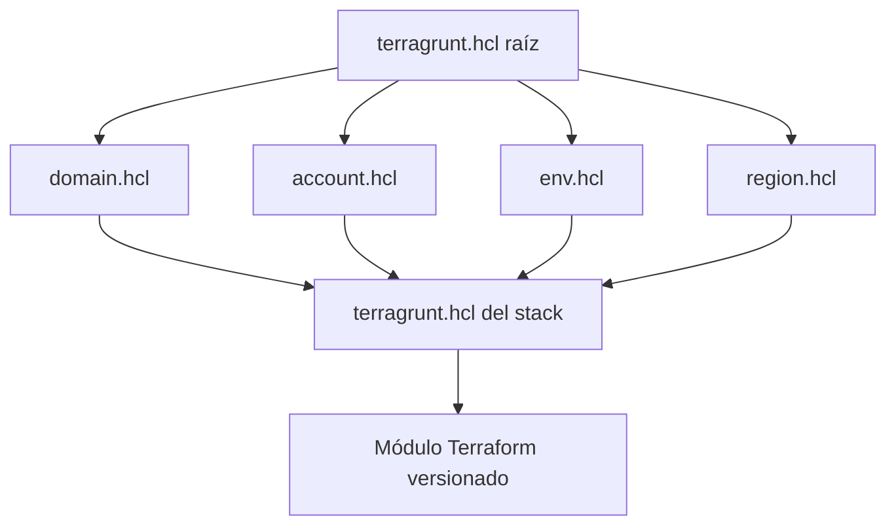

# Terragrunt y configuración live

## Propósito

Define la jerarquía de configuración HCL, la composición de stacks y la parametrización por dominio, 
cuenta, ambiente y región.

### Parametrización multiambiente

#### Terragrunt raíz

Cada repositorio `live` contendrá exactamente `dev`, `qa`, `stg` y `prod` y tendrá un `terragrunt.hcl` raíz
encargado de:

- Generar el backend.
- Generar el provider.
- Aplicar tags comunes.
- Configurar el rol cross-account.
- Estandarizar versiones.

En repositorios de workload leerá `domain.hcl`, `env.hcl`,
`account.hcl` y `region.hcl`. En repositorios fundacionales leerá
solo los archivos que correspondan a su alcance, cuenta y región.

#### Dominio

```hcl
# domain.hcl

locals {
  domain      = "diners"
  scope       = "diners"
  owner       = "equipo-app"
  cost_center = "123456"
}
```

#### Cuenta Dev

```hcl
# live/dev/account.hcl

locals {
  account_id   = "111111111111"
  account_name = "dinersclub-diners-dev"
}
```

#### Ambiente Dev

```hcl
# live/dev/env.hcl

locals {
  environment = "dev"

  default_tags = {
    Environment        = "dev"
    Domain             = "diners"
    Scope              = "diners"
    Owner              = "equipo-app"
    DataClassification = "internal"
    Compliance         = "general"
    ManagedBy          = "terraform"
  }
}
```

#### Cuenta Prod

```hcl
# live/prod/account.hcl

locals {
  account_id   = "222222222222"
  account_name = "dinersclub-diners-prod"
}
```

#### Ambiente Prod

```hcl
# live/prod/env.hcl

locals {
  environment = "prod"

  default_tags = {
    Environment        = "prod"
    Domain             = "diners"
    Scope              = "diners"
    Owner              = "equipo-app"
    DataClassification = "pci"
    Compliance         = "pci-dss"
    ManagedBy          = "terraform"
  }
}
```

#### Región

```hcl
# region.hcl

locals {
  aws_region  = "us-east-1"
  region_code = "use1"
}
```

#### Stack EKS

```hcl
# live/prod/us-east-1/platform/eks/terragrunt.hcl

include "root" {
  path = find_in_parent_folders("terragrunt.hcl")
}

terraform {
  source = "git::ssh://git@github.com/Diners/dcp-terraform-modules.git//modules/platform/eks?ref=7f3c2a1986d4b50e2f01897ca640d5bb18e2a417"
}

inputs = {
  cluster_name = "dcp-diners-prod-platform-eks-use1"

  node_instance_types = [
    "m7i.xlarge"
  ]

  min_nodes     = 3
  desired_nodes = 6
  max_nodes     = 15
}
```

## Jerarquía de resolución



## Reglas

### Configuración explícita

- Los valores globales deben existir en el archivo de mayor alcance que los gobierna.
- Los valores de cuenta no deben declararse dentro de módulos reutilizables.
- Los valores de ambiente no deben repetirse en cada stack cuando puedan heredarse.
- Las excepciones locales deben estar documentadas junto al stack.
- Terraform se ejecuta con `1.15.8` y Terragrunt con `1.0.4`; el cambio de minor requiere actualizar y probar
  `Platform/Repositorios/compatibility.yaml` antes de modificar las imágenes de runner.
- `catalogos-cloud.yaml` se carga o genera en CI; no se duplican listas de valores permitidos en cada stack.

### Composiciones

Las composiciones deben agrupar módulos que se despliegan como una capacidad coherente, pero no deben
convertirse en módulos monolíticos que oculten recursos no relacionados.

Una composición puede definir el baseline de un workload o plataforma. El directorio `live` conserva la decisión de:

- Cuenta.
- Ambiente.
- Región.
- Capacidad.
- Versión del módulo.
- Dependencias.
- Parámetros de tamaño.

### Dependencias Terragrunt

Los bloques `dependency` deben utilizarse solo cuando exista una dependencia real de despliegue. Las cadenas extensas
deben evitarse mediante la publicación de outputs estables en servicios AWS autorizados.

Los `mock_outputs` solo pueden utilizarse en validaciones o planes no productivos y no deben
habilitar un `apply` con identificadores simulados.
