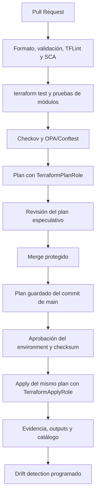

# Pipelines, Policy as Code y seguridad de Terraform

## Propósito

Define identidades, etapas del pipeline, controles automáticos, tratamiento del plan, drift, secretos y separación entre políticas Terraform y Kubernetes.

## Templates

Este documento es la fuente normativa para Terraform y Terragrunt. Cada repositorio `live` debe invocar
`.github/workflows/terraform-stack.yml` de `Diners/dcp-platform-pipeline-templates` por SHA completo, según
[Pipeline de Terraform](../Platform/Pipelines/02-pipeline-terraform.md).

Reglas transversales obligatorias:

- `plan` y `apply` usan identidades diferentes;
- el PR genera un plan especulativo no aplicable; después del merge, `main` genera un plan nuevo y guardado;
- `apply` ejecuta ese mismo `tfplan` de `main`, aprobado y con expiración máxima de 24 horas;
- providers y CLIs provienen de Nexus Repository;
- módulos provienen de `Diners/dcp-terraform-modules` por SHA completo aprobado;
- el pipeline no tiene egress general ni descarga herramientas en runtime;
- la evidencia registra commit, stack, cuenta, región, checksum, aprobaciones y resultado.

Las reglas de state, Terragrunt, drift, destroy y Policy as Code permanecen en esta sección Cloud.

### Provider y acceso cross-account

#### Roles por cuenta

Cada cuenta destino deberá tener:

```text
TerraformPlanRole
TerraformApplyRole
```

#### Provider

```hcl
provider "aws" {
  region = var.aws_region

  assume_role {
    role_arn = "arn:aws:iam::${var.account_id}:role/TerraformApplyRole"
  }

  default_tags {
    tags = var.default_tags
  }
}
```

#### Separación de permisos

##### TerraformPlanRole

- Lectura.
- Consulta de recursos.
- Ejecución de plan.
- Detección de drift.

No debe permitir cambios.

##### TerraformApplyRole

- Escritura limitada al alcance del repositorio.
- Sin `AdministratorAccess` permanente.
- Permission boundary obligatorio `dcp-platform-permission-boundary` para todo rol creado por Terraform; solo se
  excluyen service-linked roles creados y administrados por AWS, que el pipeline inventaría y auditaría por ARN.

---

### Pipeline estándar

#### Pull Request

```text
Pull Request
   │
   ├── terraform fmt -check
   ├── terraform validate
   ├── terragrunt hclfmt --check
   ├── tflint
   ├── checkov
   ├── OPA/Conftest
   ├── pruebas del módulo
   └── terraform plan
          │
          ▼
Plan especulativo publicado para revisión; no es aplicable
          │
          ▼
Revisión y aprobación
```

#### Apply

```text
Merge protegido a main
   │
   ▼
Generar plan guardado con el commit definitivo
   │
   ▼
Publicar checksum y solicitar aprobación del environment
   │
   ▼
OIDC
   │
   ▼
AssumeRole
   │
   ▼
terraform apply del plan aprobado
   │
   ▼
Publicar evidencia
```

#### Controles mínimos

- Protección de rama.
- Aprobaciones productivas según la matriz única de
  [roles y segregación de funciones](../Platform/Seguridad/00-roles-segregacion-funciones.md).
- Apply del plan guardado de `main` sin regenerarlo después de la aprobación.
- Escaneo de secretos.
- Escaneo IaC.
- Detección de módulos no versionados.
- Detección de providers no aprobados.
- Retención de logs y artefactos.
- Terraform, Terragrunt, providers y herramientas obtenidos exclusivamente desde Nexus Repository.
- Módulos únicamente desde repositorios Git corporativos mediante referencias inmutables.
- Bloqueo de registries, repositorios Git y URLs de descarga externas.

### Policy as Code

Estructura:

```text
policies/
├── conftest/
├── opa/
├── checkov/
├── tflint/
└── custom/
```

Validaciones mínimas:

- Prohibir recursos sin tags.
- Prohibir S3 público.
- Prohibir RDS sin cifrado.
- Prohibir EKS con endpoint público.
- Prohibir CIDR fuera de IPAM.
- Prohibir módulos consumidos desde `main`.
- Prohibir providers no aprobados.
- Prohibir módulos desde Terraform Registry público o repositorios Git externos.
- Verificar que providers, plugins y CLIs fueron descargados desde Nexus Repository.
- Prohibir NAT Gateway en workloads con egress central.
- Prohibir VPC peering no autorizado.
- Prohibir access keys.
- Prohibir secretos en `tfvars`.

#### Separación de políticas Kyverno

```text
policies/
├── terraform/
│   ├── conftest/
│   ├── opa/
│   ├── checkov/
│   ├── tflint/
│   └── custom/
│
└── kubernetes/
    └── kyverno/
        ├── cluster-policies/
        ├── namespace-policies/
        ├── exceptions/
        ├── resources/
        └── tests/
```

### Gestión de secretos

Queda prohibido almacenar secretos en:

- Git.
- `terraform.tfvars`.
- Outputs no sensibles.
- Logs.
- Variables de pipeline en texto plano.

Los secretos se gestionarán mediante:

- AWS Secrets Manager.
- Parameter Store SecureString.
- Hashicorp vault corporativo.
- Secretos de environment de GitHub, únicamente para valores que aún no admitan federación y con rotación
  automática; las variables no sensibles permanecen como variables protegidas.

La clasificación es determinista: secretos de aplicaciones en AWS Secrets Manager; parámetros sensibles de
infraestructura en Parameter Store `SecureString`; Vault corporativo solo para secretos multi-cloud o heredados.
Toda excepción tiene owner, rotación, expiración máxima de 90 días y registro central.

Los outputs sensibles deberán marcarse:

```hcl
sensitive = true
```

## Pipeline normativo



## Reglas

### Artefacto de plan

El plan aprobado debe:

- Generarse en `main` con el commit definitivo; el plan de PR es únicamente especulativo.
- Asociarse al stack y ambiente.
- Incluir checksum.
- Tener una vigencia limitada.
- Aplicarse sin regeneración silenciosa.
- Invalidarse cuando cambien código, variables, providers, módulos o estado.

Los planes pueden contener datos sensibles y deben almacenarse como artefactos protegidos con retención limitada.

### Dependency lock

Cada root module debe versionar `.terraform.lock.hcl`. El pipeline debe verificar que los cambios de provider sean explícitos y revisados. Para plataformas múltiples se deben registrar checksums de los providers requeridos.

El runner debe utilizar la configuración corporativa de `provider_installation` o mecanismo equivalente para resolver providers mediante el repositorio `dcp-terraform-provider-approved-hosted` de Nexus. La dirección lógica del provider puede conservar su namespace canónico, pero el origen efectivo de descarga debe ser el mirror corporativo. El pipeline debe fallar ante cualquier descarga desde el registry público.

### Drift detection

Cada stack productivo debe ejecutar `plan -detailed-exitcode` con una frecuencia proporcional a su criticidad.

El drift debe clasificarse como:

- Cambio autorizado pendiente de importación.
- Cambio manual no autorizado.
- Cambio administrado por AWS.
- Diferencia provocada por provider o API.
- Recurso huérfano.

La remediación no debe ejecutarse automáticamente cuando pueda reemplazar o eliminar recursos críticos.

### Destroy

Un `destroy` productivo requiere:

- Pipeline separado.
- Confirmación explícita del stack.
- Plan de destrucción revisado.
- Aprobación de Service/Stack Owner, Cloud Platform Lead.
- Aprobación adicional de Ciberseguridad para CDE, IAM, networking, logging o controles de seguridad.
- Respaldo o evidencia de retención.
- Ventana de cambio.

### Alcance de Kyverno

Kyverno se utiliza para recursos Kubernetes y políticas de admisión. No reemplaza la validación del plan Terraform.

La separación será:

```text
policies/
├── terraform/
│   ├── conftest/
│   ├── opa/
│   ├── checkov/
│   ├── tflint/
│   └── custom/
└── kubernetes/
    └── kyverno/
```

### Identidad

La identidad predeterminada de pipelines será federada mediante OIDC y credenciales temporales. Queda
prohibido utilizar access keys permanentes, credenciales personales o `AdministratorAccess` como mecanismo operativo habitual.
