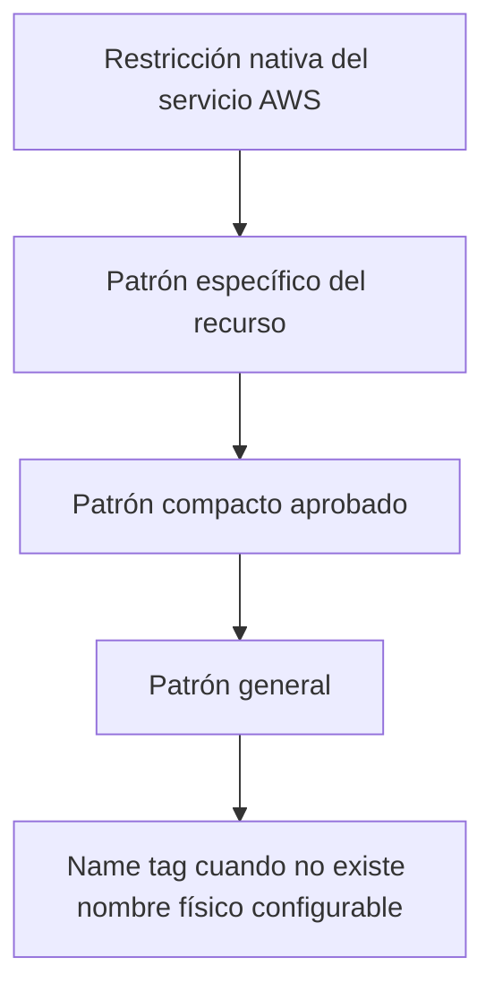

# Naming AWS: principios y catálogos

## Propósito

Define los principios generales, precedencia de reglas, catálogos controlados y convenciones de Terraform utilizadas por los demás documentos de naming.

### Convenciones de nombres para la Landing Zone AWS

#### Propósito — Convenciones de nombres para la Landing Zone AWS

Este documento define las convenciones de nombres para las
cuentas, unidades organizativas, repositorios y recursos AWS
en general.

La convención tiene un único dominio cloud permitido:

```text
Domain = diners
```

Los workloads o capacidades funcionales, como `payments`, `billing`, `collections` o `customers`, nunca se
colocan en `domain`: se registran en `workload` y permanecen dentro de las cuentas `diners`.

---

### Alcance

Esta convención aplica a todos los recursos de AWS, las restricciones nativas de cada servicio AWS prevalecen
sobre esta convención. Cuando un recurso tenga un límite menor,
se aplicará el patrón compacto definido en este documento.

---

### Principios obligatorios

#### Formato general

Salvo que una regla específica indique lo contrario, los nombres
deberán:

- Usar caracteres ASCII.
- Usar minúsculas.
- Usar `kebab-case`.
- No incluir espacios, tildes, eñes ni caracteres especiales.
- No contener guiones consecutivos.
- Ser descriptivos sin incluir información que ya esté implícita en la cuenta.
- Mantener el mismo nombre lógico entre Dev, QA, Staging y Prod.
- Usar códigos aprobados para ambiente, región y tipo de recurso.


#### Longitud general

Aunque varios servicios admiten nombres extensos, se establecen los siguientes límites internos:

| Tipo | Límite interno |
|---|---:|
| Nombre estándar | 63 caracteres |
| Nombre compacto | 32 caracteres |
| Lambda | 64 caracteres |
| Rutas de secretos y parámetros | 128 caracteres |
| Tópicos Kafka | 128 caracteres |

El objetivo es evitar truncamientos, reemplazos posteriores y convenciones distintas por servicio.

#### Orden de los componentes

Para recursos pertenecientes al dominio `diners`:

```text
dcp-<domain>-<environment>-<workload>-<resource>[-<purpose>][-<region>][-<ordinal>]
```

Ejemplo:

```text
dcp-diners-prod-payments-rds-core-use1
```

Para recursos fundacionales:

```text
dcp-<scope>-<environment>-<resource>[-<purpose>][-<region>][-<ordinal>]
```

Ejemplos:

```text
dcp-network-prod-tgw-use1
dcp-security-prod-kms-logs
dcp-platform-prod-eks-use1
```

> La región no será obligatoria en todos los nombres. Se incluirá en recursos físicos de
> infraestructura que deban diferenciarse operacionalmente entre regiones; se
> omitirá en recursos lógicos, servicios globales y recursos multi-región que
> requieran conservar el mismo nombre.

#### Elementos del nombre

| Elemento | Descripción                        | Ejemplos                                               |
|---|------------------------------------|--------------------------------------------------------|
| `dcp` | Prefijo empresarial                | `dcp`                                                  |
| `domain` | Dominio cloud; valor único           | `diners`                                               |
| `scope` | Alcance técnico o funcional          | `diners`, `data`, `platform`, `security`, `networking` |
| `environment` | Ambiente                           | `dev`, `qa`, `stg`, `prod`                             |
| `workload` | Capacidad o producto               | `payments`, `billing`, `collections`                   |
| `resource` | Código del recurso                 | `eks`, `rds`, `ddb`, `fn`, `sqs`                       |
| `purpose` | Uso específico                     | `core`, `events`, `documents`                          |
| `region` | Código corto de región             | `use1`                                                 |
| `ordinal` | Secuencia cuando existe más de uno | `01`, `02`                                             |

#### Regla de omisión

Solo se podrá omitir un componente cuando:

- El servicio no lo soporte por longitud.
- El componente ya esté representado
por la cuenta o ruta.
- La excepción esté documentada en la tabla específica del servicio.

No se debe omitir `environment` en recursos
regionales de workload, excepto en componentes globales,
KMS multiambiente expresamente aprobado o
recursos organizacionales.

---

### Catálogos controlados

#### Ambientes

| Nombre                   | Código   |
|--------------------------|----------|
| Desarrollo               | `dev`    |
| Calidad                  | `qa`     |
| Stage                    | `stg`    |
| Producción               | `prod`   |

No se utilizan variantes como `development`, `production`, `prd`, `qas`, `desa`, `cert`, `sbx` o `shared`.
`foundation`, `platform`, `security`, `networking` y `data` son scopes, nunca ambientes.

#### Regiones

En carpetas Terraform y variables se utilizará el
nombre AWS completo. En nombres físicos de recursos
regionales se utilizará el código corto.

| Región AWS | Código corto |
|---|---|
| `us-east-1` | `use1` |
| `us-east-2` | `use2` |
| `us-west-2` | `usw2` |
| `sa-east-1` | `sae1` |

Ejemplo:

```text
Carpeta: live/prod/us-east-1/platform/eks
Recurso: dcp-diners-prod-platform-eks-use1
```

#### Workloads aprobados

| Capacidad | Código |
|---|---|
| Plataforma compartida del dominio | `platform` |
| Pagos | `payments` |
| Facturación | `billing` |
| Cobranzas | `collections` |
| Clientes y socios | `customers` |
| Tarjetas | `cards` |
| Adquirencia | `acquiring` |
| Comercios | `merchants` |
| Fraude | `fraud` |
| Integraciones | `integration` |
| Canales | `channels` |

Los nombres de workload deberán corresponder a capacidades o bounded contexts; no deberán
utilizar nombres de equipos, personas, proveedores o proyectos temporales.

#### Códigos de recursos

| Recurso | Código |
|---|---|
| VPC | `vpc` |
| Subnet | `snet` |
| Route table | `rt` |
| Network ACL | `nacl` |
| Security group | `sg` |
| Internet Gateway | `igw` |
| NAT Gateway | `nat` |
| Transit Gateway | `tgw` |
| TGW attachment | `tgwatt` |
| VPC endpoint | `vpce` |
| Network Firewall | `nfw` |
| Route 53 Resolver | `r53r` |
| EKS cluster | `eks` |
| EKS node group | `ng` |
| Application Load Balancer | `alb` |
| Network Load Balancer | `nlb` |
| Target group | `tg` |
| API Gateway | `apigw` |
| Lambda function | `fn` |
| Lambda layer | `layer` |
| Step Functions | `sfn` |
| EventBridge bus | `ebus` |
| EventBridge rule | `erule` |
| EventBridge Pipe | `pipe` |
| S3 bucket | `s3` |
| Aurora PostgreSQL | `aurora` |
| RDS PostgreSQL | `rds` |
| DynamoDB | `ddb` |
| Redis/Valkey | `redis` |
| MSK | `msk` |
| SQS | `sqs` |
| SNS | `sns` |
| KMS | `kms` |
| Secrets Manager | `secret` |
| Parameter Store | `param` |
| CloudWatch log group | `log` |
| CloudWatch alarm | `alarm` |
| CloudWatch dashboard | `dash` |
| WAF Web ACL | `waf` |
| CloudFront | `cf` |
| Backup vault | `bkpv` |
| Backup plan | `bkpp` |
| Cognito User Pool | `userpool` |
| OpenSearch | `os` |
| Glue Database | `gluedb` |
| Athena Workgroup | `athena` |
| Redshift | `redshift` |
| Kinesis Data Stream | `kds` |
| Firehose | `firehose` |

### Repositorios y Terraform

#### Repositorios Git

Se mantienen las convenciones del documento de arquitectura Terraform:

```text
dcp-terraform-bootstrap
dcp-terraform-modules
dcp-aws-governance-live
dcp-aws-networking-live
dcp-aws-security-live
dcp-aws-shared-services-live
dcp-aws-diners-live
dcp-aws-data-live
```

#### Módulos Terraform

```text
<category>/<resource>
```

Ejemplos:

```text
network/vpc
network/transit-gateway
platform/eks
data/aurora-postgresql
data/dynamodb
security/guardduty-organization
```

#### Variables Terraform

Variables en `snake_case`:

```hcl
aws_region
region_code
environment
domain
scope
workload
resource_name
default_tags
```

#### Recursos Terraform

Los labels internos de Terraform usarán `snake_case` y no repetirán el nombre físico completo:

```hcl
resource "aws_lambda_function" "authorize_payment" {
  function_name = local.authorize_payment_name
}
```

No usar:

```hcl
resource "aws_lambda_function" "dcp_diners_prod_payments_fn_authorize" {
}
```

#### Estados Terraform

La ruta del estado seguirá la estructura `live`:

```text
<scope>/<environment>/<region>/<stack>/terraform.tfstate
```

Ejemplos:

```text
diners/prod/us-east-1/platform/terraform.tfstate
diners/prod/us-east-1/workloads/payments/terraform.tfstate
networking/us-east-1/core/transit-gateway/terraform.tfstate
```

## Precedencia de reglas

Cuando existan varias reglas aplicables, se utilizará este orden:



- La restricción nativa del servicio prevalece.
- El patrón específico prevalece sobre el general.
- El patrón compacto solo se utiliza cuando existe una restricción documentada.
- Los identificadores generados por AWS se complementan mediante tags.
- Las excepciones no crean nuevos catálogos de manera implícita.

## Decisiones de consistencia

### Dominio

El valor único de `domain` es `diners`. Los nombres `payments`, `billing`, `cards` y `acquiring` se ubican
exclusivamente en `workload`.

### Ambiente

El catálogo normativo es:

```text
dev | qa | stg | prod
```

El archivo `catalogos-cloud.yaml` es la fuente de verdad. Estas tablas son una representación documental y
deben validarse contra ese archivo en CI.

### Región

- Carpetas y variables usan el nombre AWS completo, por ejemplo `us-east-1`.
- Nombres físicos regionales usan el código corto, por ejemplo `use1`.
- Recursos globales o lógicos omiten la región.
- No se incorpora región únicamente por consistencia estética.

## Códigos adicionales

Se agregan los siguientes códigos controlados:

| Recurso | Código |
|---|---|
| EKS Pod Identity Association | `podid` |
| RDS Proxy | `rdsproxy` |
| EventBridge Scheduler | `sched` |
| ACM Certificate | `acm` |
| EFS | `efs` |

La incorporación de códigos adicionales requiere actualizar este catálogo y las validaciones de CI/CD.
