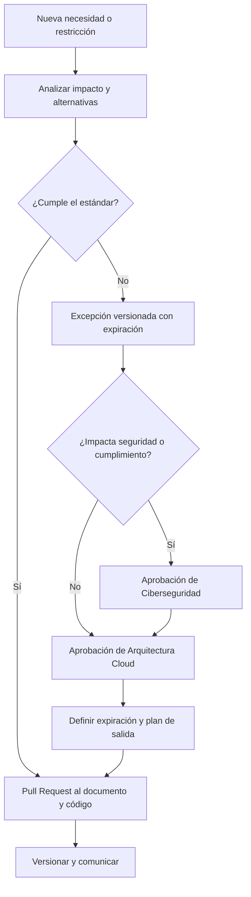

# Gobierno, excepciones y mantenimiento del estándar cloud

## Propósito

Define el proceso de aprobación, manejo de excepciones, antipatrones, ownership documental y evolución
de los estándares Terraform y AWS.

## Antipatrones

No se permitirá:

- Un único monorepo para toda la Landing Zone.
- Un repositorio diferente por ambiente.
- Un repositorio diferente por recurso AWS.
- Un estado único para toda una cuenta.
- Un estado único para todo un dominio.
- Copiar módulos entre repositorios.
- Consumir módulos desde `main`.
- Separar ambientes con Terraform workspaces.
- Ejecutar apply productivo desde laptops.
- Access keys permanentes.
- `AdministratorAccess` para pipelines.
- Secretos en Git.
- VPC peering ad hoc.
- NAT Gateway en workloads que deben usar egress central.
- Recursos sin tags obligatorios.
- Cambios manuales no regularizados.

## Excepciones

Las excepciones se registran en `Diners/dcp-platform-policies`, ruta `exceptions/cloud/<exception-id>.yaml`.
El identificador cumple `^exc-cloud-[0-9]{4}-[0-9]{4}$`; el schema y el ejemplo normativo están en
`Platform/Ejemplos/policies/cloud-exception.yaml`. Una excepción deberá documentar:

- Servicio afectado.
- Restricción técnica que impide usar el estándar.
- Nombre solicitado.
- Nombre estándar que no pudo utilizarse.
- Cuenta y ambiente.
- Owner.
- Riesgo, controles compensatorios, plan de salida y evidencia verificable.
- Fecha de inicio y expiración obligatoria, máximo 180 días.
- Estado `proposed`, `approved`, `expired` o `closed`.
- Aprobación de Arquitectura Cloud.
- Aprobación de Ciberseguridad si afecta IAM, cifrado, red, Internet, logging/auditoría, datos `confidential`,
  `restricted` o `pci`, o cualquier workload CDE.

Las excepciones no amplían catálogos ni se renuevan de forma automática. El pipeline bloquea excepciones
expiradas, owners inexistentes, aprobaciones incompletas o recursos fuera del alcance declarado.

## Flujo de cambio

## Ownership documental

| Tema | Owner principal | Co-owner o aprobador |
|---|---|---|
| Arquitectura Terraform | Arquitectura Cloud | Infraestructura Cloud |
| Módulos y Terragrunt | Infraestructura Cloud | DevOps / Platform Engineering |
| Networking | Infraestructura Cloud | Ciberseguridad |
| Governance y Organizations | Infraestructura Cloud | Ciberseguridad |
| Seguridad cloud | Ciberseguridad | Infraestructura Cloud |
| Naming y tags | Arquitectura Cloud | FinOps, Seguridad e Infraestructura |
| Pipelines | DevOps / Platform Engineering | Seguridad e Infraestructura |

## Revisión periódica

El estándar debe revisarse:

- Cuando AWS o Terraform introduzcan cambios relevantes.
- Cuando se habilite una nueva región o ambiente.
- Cuando se cree un nuevo dominio, cuenta o repositorio.
- Cuando se incorpore un nuevo servicio AWS al catálogo.
- Después de incidentes causados por naming, estado, permisos o drift.
- Como mínimo una vez al año.

## Versionamiento documental

Los cambios se clasifican como:

- `patch`: aclaraciones y ejemplos sin cambio normativo.
- `minor`: nuevas reglas compatibles.
- `major`: cambios que requieren migración de repositorios, nombres, estados o pipelines.

## Regla de no retroactividad automática

Una nueva convención no obliga a renombrar inmediatamente recursos existentes cuando el cambio implique reemplazo, indisponibilidad o riesgo. Debe definirse:

- Inventario afectado.
- Beneficio.
- Riesgo.
- Estrategia de migración.
- Uso de `moved` o `import`.
- Ventana.
- Plan de rollback.

## Evidencia de cumplimiento

Los pipelines deben publicar:

- Resultado de validaciones.
- Plan aprobado.
- Identidad utilizada.
- Aprobadores.
- Evidencia de apply.
- Outputs autorizados.
- Resultado de drift.
- Excepciones vigentes.
